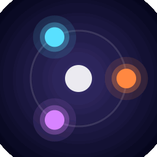
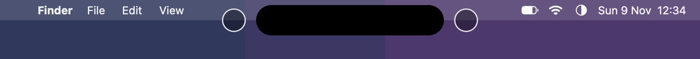
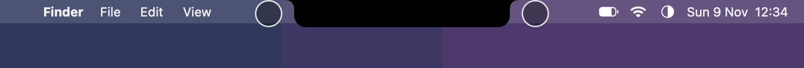
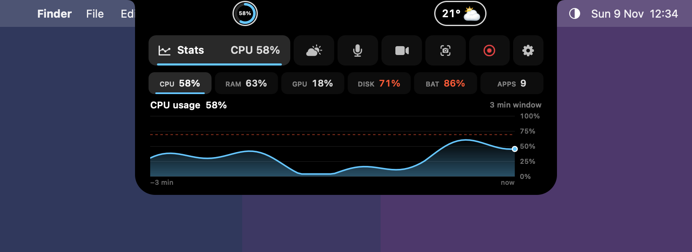
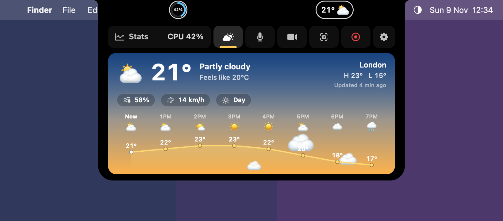
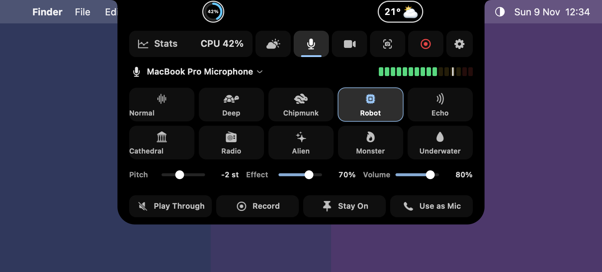
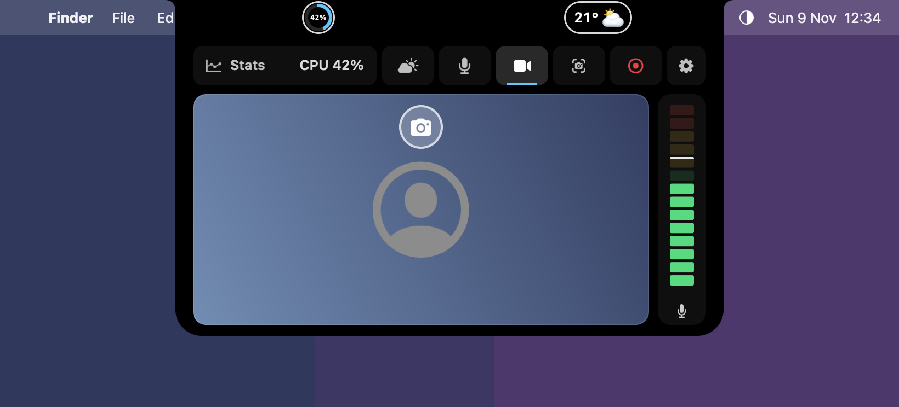
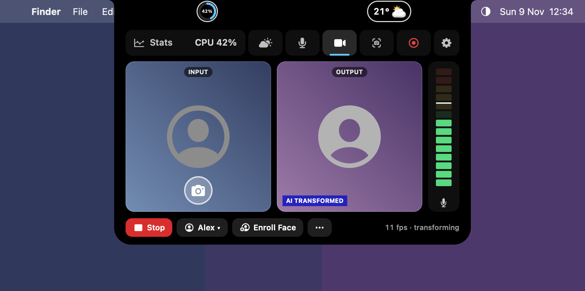
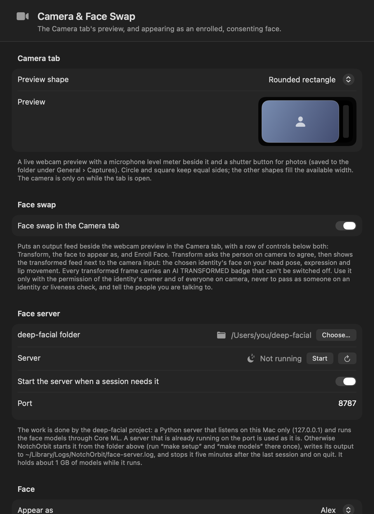
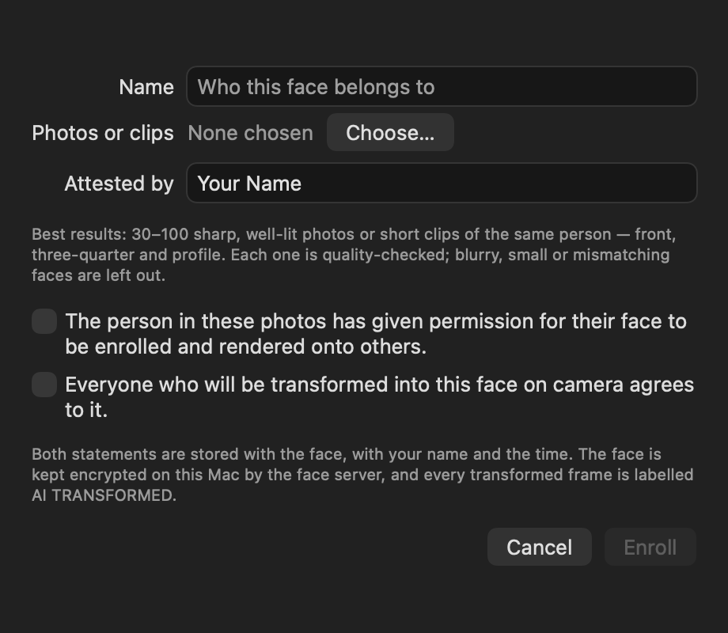

# NotchOrbit

[](../../actions/workflows/build.yml)


[](LICENSE)

A tiny macOS menu-bar app that dresses up the MacBook notch. It puts circles on either
side of the notch (plain, live system-stat gauges, or the weather), reshapes the notch
with a black overlay, gives notch-less displays a Dynamic Island, and expands into a
panel with system graphs, a weather scene, a voice changer and a webcam tab with an
optional, consent-gated face swap.

Version 2.0.0 · macOS 13 or later · Apple silicon and Intel · no third-party dependencies



## Contents

- [Features](#features)
- [Requirements](#requirements)
- [Install](#install)
- [Build and run from source](#build-and-run-from-source)
- [First run and permissions](#first-run-and-permissions)
- [Face Transform](#face-transform-optional)
- [Screenshots](#screenshots)
- [Documentation](#documentation)
- [Contributing](#contributing)
- [License and acknowledgements](#license-and-acknowledgements)

## Features

| | |
|---|---|
| **Circles beside the notch** | A tinted disc on each side; size, gap, offset and border are adjustable. They can also sit inside the notch (attach mode). |
| **Notch shapes** | Original, Rounded, Island (pill), Square, Wide, or Custom with sliders. Overlay colour is configurable. |
| **Dynamic Island** | Displays without a notch get a virtual island, floating as a pill or hanging from the top edge. |
| **System stats** | The left circle becomes a ring gauge for CPU, memory, GPU, disk, battery or app count; the right one shows an animated 🔥 / ❄️ against your threshold. Click the gauge for the panel. |
| **Weather** | Current conditions and temperature in the right circle (Open-Meteo, no account), a full-screen weather animation on click, and a Weather tab with an hourly curve. |
| **Voice changer** | Ten effects, pitch and amount, playthrough, recording, and **Use as Mic**: the changed voice becomes a system microphone for FaceTime, Teams, Zoom and others, with echo cancellation. |
| **Camera tab** | Live webcam preview in five outlines, photo shutter, microphone level meter. |
| **Face Transform** | Optional. Shows you as an enrolled, consenting face using a local server; input and output feeds side by side, enrolment, and a virtual camera for calls. Every transformed frame is labelled AI TRANSFORMED. |
| **Capture** | Screenshot and screen-recording buttons that leave NotchOrbit's own overlay out. |
| **Lightweight** | About 17 MB of memory when idle, a 3.2 MB universal app, menu-bar only, optional launch at login. |

The full description of every feature is in [docs/FEATURES.md](docs/FEATURES.md).

## Requirements

To **run** a release build:

- macOS 13 (Ventura) or later
- A MacBook with a notch for the notch features; any Mac or external display gets the Dynamic Island instead

To **build** from source:

- macOS 13 or later
- Xcode 15 or later (Swift 5.9+), installed in /Applications. The Command Line Tools
  alone are not enough on current SDKs: the Settings window uses SwiftUI, whose macros
  ship only with Xcode. Xcode does not have to be the selected toolchain; `build.sh`
  finds it by itself.

Optional, per feature:

| Feature | Needs |
|---|---|
| Use the changed voice as a microphone | A loopback audio driver. [BlackHole 2ch](https://existential.audio/blackhole/) is free; Settings › Microphone can download and verify it for you. |
| Face Transform | The companion face server (Python 3.11+, about 830 MB of models, Apple silicon recommended). See [docs/FACE_TRANSFORM.md](docs/FACE_TRANSFORM.md). |
| Face Transform on video calls | [OBS Studio](https://obsproject.com) 30 or later, for its virtual camera extension. |

## Install

Download `NotchOrbit-<version>.dmg` from the [Releases](../../releases) page, open it and
drag **NotchOrbit** onto the **Applications** shortcut. Launch it from Applications; it
appears as a half-filled circle in the menu bar (there is no Dock icon).

Builds that are not notarized are held back by Gatekeeper on first launch:

- **macOS 15 or later**: macOS says the app "could not be verified". Click *Done*, open
  System Settings › Privacy & Security, scroll down and click **Open Anyway** next to
  NotchOrbit, then confirm. This is needed once.
- **macOS 13 / 14**: right-click the app in Applications, choose *Open*, then *Open*.
- **Terminal alternative**: `xattr -dr com.apple.quarantine /Applications/NotchOrbit.app`

## Build and run from source

```bash
git clone https://github.com/MUHAMMAD-TALHA-TARIQ/NotchOrbit.git
cd NotchOrbit
./run.sh
```

`main` always holds the latest code and is what a plain `git clone` gives you. Released
versions are tags: run `git checkout v2.0.0` after cloning to build exactly what was
released, or download the ready-made app from the [Releases](../../releases) page.

`run.sh` builds a release, assembles `build/NotchOrbit.app` and launches it. Other entry points:

```bash
./build.sh debug          # debug build into build/NotchOrbit.app
./build.sh                # release build (universal, size-optimised, stripped)
ARCHS=arm64 ./build.sh    # Apple-silicon-only release, about half the size
./make-dmg.sh             # release build + DMG in build/NotchOrbit-<version>.dmg
./build.sh clean          # remove build/ and SwiftPM's .build/
```

Always launch the assembled `.app`, not the bare executable: the camera, microphone and
login-item features need the bundle's `Info.plist`.

Builds are ad-hoc signed, which is fine on your own Mac. Signing with a Developer ID,
notarizing and cutting a release are covered in [docs/RELEASING.md](docs/RELEASING.md).

## First run and permissions

On first launch the Settings window opens and the notch gets the Rounded overlay. Turn on
**System Stats** to get the gauge; clicking the gauge opens the panel.

macOS asks for each permission the first time the feature that needs it is used:

| Permission | Used by | Notes |
|---|---|---|
| Camera | Camera tab, Face Transform | Only on while the tab is open, or while a face session is pinned to the virtual camera |
| Microphone | Camera tab meter, Mic tab | "Use as Mic" keeps listening in the background until switched off |
| Screen Recording | Screenshot and record buttons | Needs a relaunch after allowing |
| Location | Weather with "Current location" | Choosing a city needs no permission |

The current state of each is shown under Settings › General › Privacy. The app's version
is shown at the top of the menu-bar menu, in the Settings sidebar and under Settings ›
General › About.

## Face Transform (optional)

Face Transform is off by default and needs a separate, local face server; nothing is
bundled and nothing leaves your Mac. In short:

1. Set up the server (Python 3.11+, `make setup && make models`, about 830 MB).
2. In NotchOrbit open Settings › Camera & Face Swap, switch on **Face swap in the Camera
   tab** and choose the server's folder.
3. Open the Camera tab, pick or enroll a face, and press **Transform**.

The complete setup, the options, the wire protocol and the rules for using it are in
[docs/FACE_TRANSFORM.md](docs/FACE_TRANSFORM.md).

**Use it responsibly.** Enrol and appear as a person only with that person's permission
and the agreement of everyone on camera. Do not use it to impersonate anyone, to pass
identity or liveness checks, or to present transformed video as authentic. Tell the
people you are talking to. The AI TRANSFORMED badge cannot be switched off.

## Screenshots

Every face the notch can wear, as the app draws it on a 14" MacBook Pro.

**Notch shapes** · Original, Rounded, Island (pill), Square, Wide, and the circles attached to the notch


**System stats mode** · the left circle is a live gauge, the right one shows ❄️ below your threshold and 🔥 above it


**Weather mode** · temperature and condition in the right circle, with or without the stats gauge


**Dynamic Island on an external display** · floating pill, or hanging from the top edge like a notch




**The expanded panel** · click the gauge: Stats, Weather, Mic and Camera tabs, plus screenshot, record and settings buttons

| Stats tab | Weather tab |
|---|---|
|  |  |

| Mic tab | Camera tab |
|---|---|
|  |  |

**Face Transform** · the Camera tab with input and output feeds and the control row, the Settings page, and the Enroll Face window



| Settings › Camera & Face Swap | Enroll Face |
|---|---|
|  |  |

The images are rendered by the app's own view code (`Tools/render-screenshots.swift`) on a mock
desktop, so they stay in step with the source; the particle animations and the live camera
feed are stand-ins.

## Documentation

| Document | Contents |
|---|---|
| [docs/GETTING_STARTED.md](docs/GETTING_STARTED.md) | Requirements, building, first run, permissions, troubleshooting |
| [docs/FEATURES.md](docs/FEATURES.md) | Every feature and setting in detail |
| [docs/FACE_TRANSFORM.md](docs/FACE_TRANSFORM.md) | Face server setup, usage, protocol, privacy and acceptable use |
| [docs/VOICE_CHANGER.md](docs/VOICE_CHANGER.md) | Voice effects, "Use as Mic", loopback driver, how the audio chain works |
| [docs/ARCHITECTURE.md](docs/ARCHITECTURE.md) | Project layout, how the overlay works, footprint, implementation notes |
| [docs/RELEASING.md](docs/RELEASING.md) | Versioning, signing, notarizing, the DMG |
| [CHANGELOG.md](CHANGELOG.md) | Release notes |

## Contributing

Bug reports and pull requests are welcome. See [CONTRIBUTING.md](CONTRIBUTING.md) for
how to build, the code conventions and what a good report contains. Security issues:
see [SECURITY.md](SECURITY.md).

## License and acknowledgements

NotchOrbit is released under the [MIT License](LICENSE).

It relies on these separately licensed projects and services, none of which are bundled:

- [Open-Meteo](https://open-meteo.com) for weather data (CC BY 4.0)
- [BlackHole](https://github.com/ExistentialAudio/BlackHole) by Existential Audio as the loopback driver (GPL-3.0; downloaded from its publisher on request, checksum verified)
- [OBS Studio](https://obsproject.com) for the virtual camera (GPL-2.0)
- The face server's models (InsightFace `buffalo_l` and `inswapper_128`) are under a **non-commercial research licence**. That restriction applies to Face Transform regardless of NotchOrbit's own licence.
